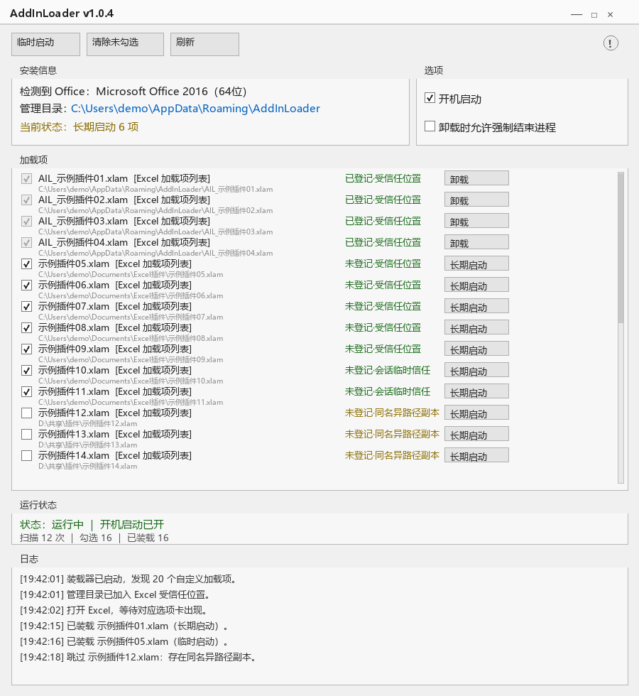

# AddInLoader v1.0.4

由第三方软件以 COM 自动化启动的 Excel 实例不会加载自定义加载项。AddInLoader 常驻扫描已打开的 Excel 窗口，将指定的 `.xlam` / `.xla` 装载到这类实例中，使对应功能区选项卡正常出现。

> **设计定位**
>
> AddInLoader 保持轻量：长期启动的加载项副本仅存放于 `%APPDATA%\AddInLoader`，并将该目录登记为 Excel 受信任位置。不引入需要管理员维护的安装部署，不写系统级注册表，不注册服务，不挂钩子。exe 按清单请求管理员权限，仅用于附着以管理员身份运行的 Excel 实例。
>
> 该目录为用户可写：同一账号下的任意进程均可替换其中的加载项副本。这是明确的设计取舍，而非缺陷——全部状态集中在这一个普通目录内，可整体替换、整体删除，不产生系统级残留；删除该目录后，系统基本恢复到部署前的状态。
>
> 若机器上存在不可信软件，或账号为多人共用，建议仅使用「临时启动」，并将加载项源文件置于自管目录。

## 界面预览

装载 20 个加载项时的主界面（列表可滚动）：

## 环境要求

- Windows + Microsoft Excel（无需安装 Python 或运行库，依赖已打包进 exe）
- 首次运行需在用户账户控制提示中确认提升权限

## 安装

请到发布页面下载安装包：**[Release 页面](https://github.com/YehOlt/AddInLoader/releases)**，在最新版本下展开 **Assets**，下载 `AddInLoader_vx.x.x.exe`（x 为版本号，取最新版本即可），双击运行，无需安装依赖。

首次运行需在用户账户控制提示中确认提升权限。

## 启动

按上文【安装】一节获取 `AddInLoader_vx.x.x.exe`，双击打开主界面。命令行参数：

| 命令 | 作用 |
|---|---|
| `AddInLoader_vx.x.x.exe` | 图形界面（日常使用） |
| `AddInLoader_vx.x.x.exe --background` | 静默驻留托盘、不显示窗口（开机启动项用此参数） |
| `AddInLoader_vx.x.x.exe --selfcheck` | 环境与依赖自检 |
| `AddInLoader_vx.x.x.exe --xlam "路径\xlam文件"` | 只装载指定的 xlam，跳过自动发现（排障用，按会话临时信任） |

程序为单实例运行，重复启动不会创建第二个窗口。

**开机启动说明**：在选项区勾选后注册开机启动，仅在用户登录时运行，静默驻留托盘，不再每次触发 UAC 提示。旧版注册项在下次启动时自动迁移并删除，不会重复注册。取消勾选或在托盘菜单中关闭时立即取消开机启动。开机启动设置失效时，界面给出提示。

## 主界面使用

- **加载项列表**：自动发现已登记的加载项，默认全选；每行显示「已登记/未登记」与四种信任状态。
- **临时启动**：点击顶部按钮选择 xlam，即时装载到所有已打开的 Excel。不写注册表、不复制文件；该文件按「会话临时信任」处理，装载器退出或取消勾选后失效。
- **清除未勾选**：取消勾选仅停止后续装载，已装载进 Excel 的加载项保留至该 Excel 关闭，重启装载器亦不会清除。点击该按钮可立即将其从 Excel 卸载并移出临时列表，Excel 与装载器均无需重启。不删除源文件，不影响长期启动项。
- **长期启动**：在对应行点击「长期启动」，xlam 复制至管理目录（副本加 `AIL_` 前缀），该目录自动登记为 Excel 受信任位置并写入 OPEN 登记；已登记项的勾选框锁定，仅可通过「卸载」移除。
- **卸载**：在对应行点击「卸载」，撤销 OPEN 登记、删除目录副本、清除受信任位置（该目录已无其他长期副本时）。若 Excel 正在运行，按「安全与行为说明」第 4 条等待并确认，不直接结束进程。
- **选项区**：开机启动；卸载时允许强制结束进程（高级，默认关闭）。
- **开机启动自动取消**：列表中**没有可装载目标**（全部取消勾选，或加载项文件被删除）时，开机启动自动取消，选项区勾选同步取消；只要尚存一个有效目标即保留。启动初期暂不判断，避免自动发现未完成时误取消。
- **刷新**：重新扫描已登记的加载项。
- **管理目录**：安装信息区的蓝色路径可点击，在资源管理器中打开。配置与加载项副本均保存于该目录。

## 托盘与退出

- 点击窗口 X 或「关闭」：隐藏至系统托盘，后台继续扫描（首次隐藏时给出提示）。
- 托盘**左键**：显示/隐藏主界面；**右键**：菜单含「显示窗口 / 开机启动 / 退出」。
- 仅托盘右键菜单「退出」会结束进程。
- 首次启动自动弹出关于窗口（含两种启动模式对比），5 秒后自动关闭；此后点击右上角感叹号可随时查看。

## 两种启动模式

| | 临时启动 | 长期启动 |
|---|---|---|
| 作用范围 | 装载器运行时持续装载 | 下次手动打开 Excel 自动加载 |
| 注册表 | 不写 | 写 OPEN + 受信任位置 |
| 文件 | 用原文件 | 复制到管理目录（AIL_ 前缀） |
| 装载器退出后 | 失效 | 仍有效 |

两者互补：长期启动覆盖手动打开 Excel 的场景；以自动化方式启动的实例仍需装载器常驻扫描并装载。

## 安全与行为说明

1. **仅作用于 Excel**：加载项只装载到真正的 Excel 进程；WPS 表格即使窗口结构相同，也不作为装载目标。
2. **信任状态校验**：加载项按四种信任状态区分——已登记、会话临时放行、同名异路径、未受信任。同名文件更换路径后一律不装载，其宏代码也不会执行。
3. **不持有加载项引用**：装载完成后即释放对加载项工作簿的引用，不长期占用。卸载前先核对目标是否为本程序装载的那一份，不会关闭用户自行打开的其他工作簿。
4. **关闭 Excel 前先确认**：卸载或转为长期启动前，先提示保存并轮询等待（最长 45 秒）；超时后须经确认才强制结束进程。高级选项可启用「超时自动强制结束」，默认关闭。
5. **多版本自动接管**：同一台机器存在多个版本时，由最高版本生效。旧版先运行时由新版接管；新版已运行时旧版不再启动。无法识别版本的文件一律不参与接管。
6. **检查更新**：在关于窗口点击「检查更新」。检测到新版本时弹出对话框，提供「直接下载 / 发布页 / 暂不更新」三个选项，安装由用户自行完成；已是最新版时提示「当前已是最新版 vX.Y.Z」；网络不可用时可选择打开发布页手动查看。
7. **启动时静默检查**：每次启动在后台静默检查一次新版本，不影响界面操作。无新版本或网络不可用时不作任何提示；仅检测到新版本时弹窗询问，用户不作选择则不执行任何操作。与手动「检查更新」互不影响。
8. **设置即时生效**：长期启动后自动将管理目录登记为 Excel 受信任位置，界面状态同步更新；移除最后一个长期副本时自动撤销该登记。登记失败时加载项仍正常装载，状态显示红色「未受信任」并给出提示。
9. **临时项即时清理**：「清除未勾选」仅处理已取消勾选的临时启动项，不涉及长期启动项、不删除源文件，也不影响未勾选的自动发现项。

## 许可

[MIT License](https://github.com/YehOlt/AddInLoader/blob/main/LICENSE)
